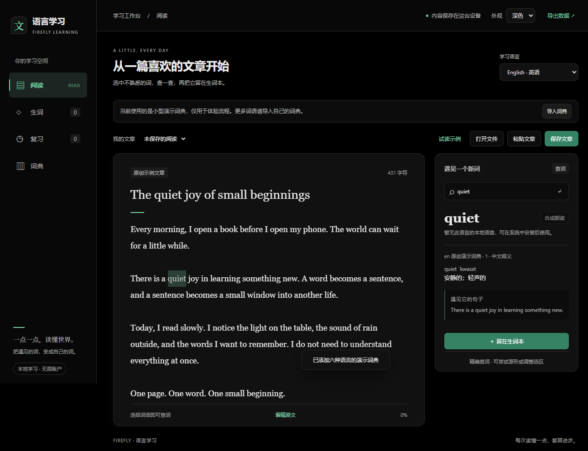

# 黑底与流萤绿定稿

用户最终指定深色「黑底＋绿色」，并明确绿色使用「流萤绿」。此记录替代此前墨灰/低饱和绿设计，浅色及过渡动效保留。

- 页面底色#000000，侧栏#080808，阅读/查词/弹窗统一#111111，灰色边框#2a2a2a。
- 强调色为官方流萤绿#7BD8AE，主按钮#318364，成功色#6FD6A4。已直接核对Firefly-Agent origin/main的react-root.css原值；未使用其他草绿或自行调配的薄荷色替代。
- Native窗口初始背景同步为#000000；主题ID、保存键、启动时应用逻辑、浅色颜色和动效实现均保留。
- npm test142项通过，build/check通过，其他六个插件包哈希不变。实际Electron记录`.test-tmp-learning-native-ZqT3Ui/native-result.json`通过，包含黑底/绿色/面板色、主题重开、页面/弹窗动效、减少动态效果以及原学习操作。
- 当前截图和实际操作录屏已刷新；均使用隔离数据和原创示例词典。代码变更仅涉及颜色、对应验证值、说明和预览；没有新增依赖或更改数据行为。

[实际动效录屏](images/learning-motion.mp4) · [深色弹窗](images/learning-collect-dark.png)

继续更新现有PR6，目标main；没有合并或发布Release。
