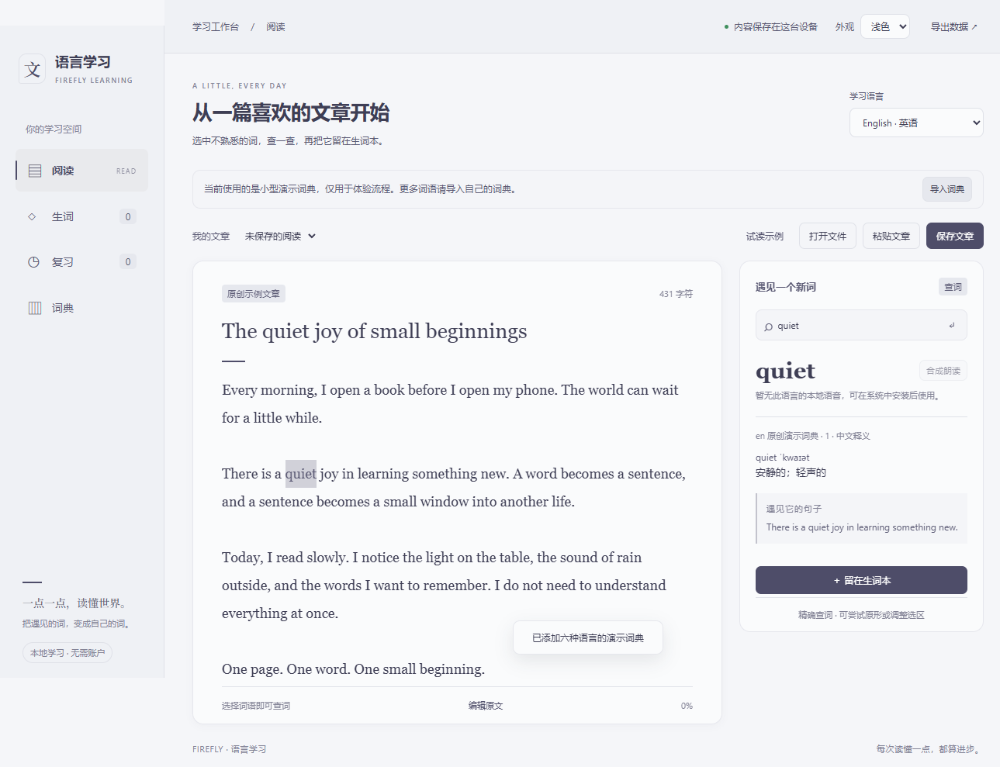
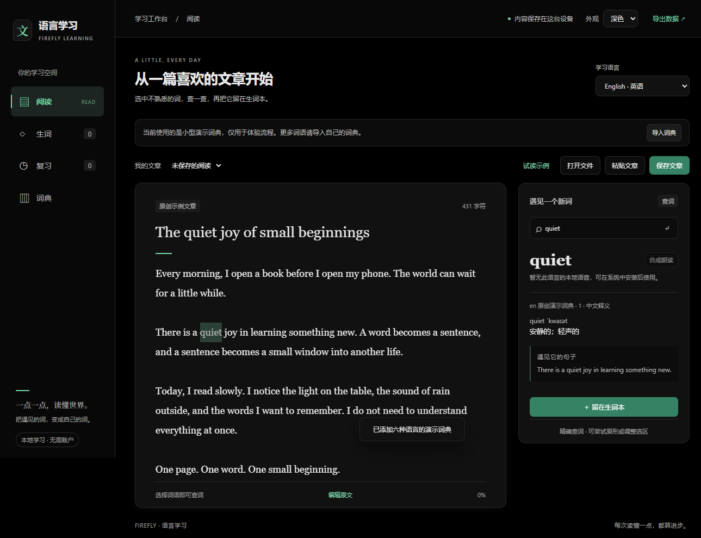

# 面板协调、深色绿色重做与过渡动效

后续用户已指定黑底＋官方流萤绿，最终颜色与当前预览见[定稿记录](2026-11-01-learning-black-green.md)。下文保留本轮早期墨灰方案及验证过程。

按用户2026-11-01的两次反馈继续更新PR6：先调整面板与颜色协调并增加过渡动画，再重做深色绿色。基线8a74e05；没有修改卡片、迁移、词典或工具行为。

## 最终外观

浅色保留冷灰蓝底色。深色改为中性墨灰框架#161b18、工作区#1b201e、统一面板#222825，绿色减少到低饱和强调色#8bbca6和主按钮#426a58。阅读、查词、弹窗使用相同面板底色与边框，表单使用内凹层次；减轻阴影和大面积选中底色，增加细选中标记，提高小字可读性。

这一版按新反馈调整插件自己的深色设计，不再宣称逐字复制宿主的旧墨绿/炭灰混合面板角色；宿主主题标识、浅色基调与来源许可仍保留。

| 浅色实际窗口 | 重做后的深色实际窗口 |
| --- | --- |
|  |  |

[实际操作动画录屏（3.24秒）](images/learning-motion.mp4) · [深色确认弹窗](images/learning-collect-dark.png)

录屏由真实Electron插件页面录制，131帧，不是动画示意图；内容仅为原创示例文章/演示词典，不含生产用户数据。展示主题切换、页面进入、弹窗打开与关闭。视频只用于文档预览，不进入插件包。

## 动效与兼容

- 页面进入180ms、查词结果160ms、通知160ms；只用透明度和5px短位移，不动画化布局高度。
- 弹窗打开/关闭180ms，采用原生dialog的display/overlay离散过渡和starting-style，保留原生焦点与关闭语义；不人为延迟保存、评分或导入。
- 主题使用180ms淡入淡出，保存成功后切换；初始打开立即应用保存值。浏览器不支持、截图失败或动画被跳过时仍应用已保存的主题。
- 系统prefers-reduced-motion:reduce时关闭CSS过渡、页面/弹窗动画及JS主题动画；弹窗正常可见、可操作。

浏览器接口核对：[Document.startViewTransition](https://developer.mozilla.org/en-US/docs/Web/API/Document/startViewTransition)、[dialog动画说明](https://developer.mozilla.org/en-US/docs/Web/HTML/Reference/Elements/dialog#animating_dialogs)。新motion.css作为可读资源列入package-files及原生资源白名单，没有新依赖。

## 验证

- npm test：**142通过，0失败/跳过**；npm run build、npm run check通过，原六个其他插件包哈希不变。
- 新动画测试先观察RED（主题没有调用过渡）；另一个真正拒绝ready Promise的回归先观察未处理异常RED。实现后6项主题测试通过，所有原保存失败/初始主题/禁用期间操作检查保留。
- 独立审查发现ViewTransition.ready拒绝未捕获，修复后复审通过；随后根据用户新配色反馈做限定复查，主题/窗口10项测试通过。详见learning-motion-review报告。
- 实际Electron最终记录：`.test-tmp-learning-native-FC8RtP/native-result.json`，passed:true。阅读、查词和弹窗底色一致；主题切换调用原生view transition；监听到词汇页learning-enter动画和collect-dialog透明度过渡。
- 减少动态效果的实际记录：dialogAnimations:0、opacity:1、tabAnimation:none；切换深浅主题未新增view transition调用。重新启用后的主题/卡片/文章保留，六语言演示、收藏、评分与日语本地朗读回调同轮通过。
- 新深色抽样对比度：主文字11.37:1、次文字7.40:1、提示文字5.85:1、强调色7.04:1、主按钮白字6.11:1。浅色沿用此前配色，不宣称做了全产品可访问性认证。

运行入口仍为 `node scripts/validation/learning-native.cjs <已构建的Firefly宿主根>`。本轮没有重导入真实词典或重新做词库性能测试，原功能验收记录继续保留。更新现有PR6至main，未合并、未发布Release。
