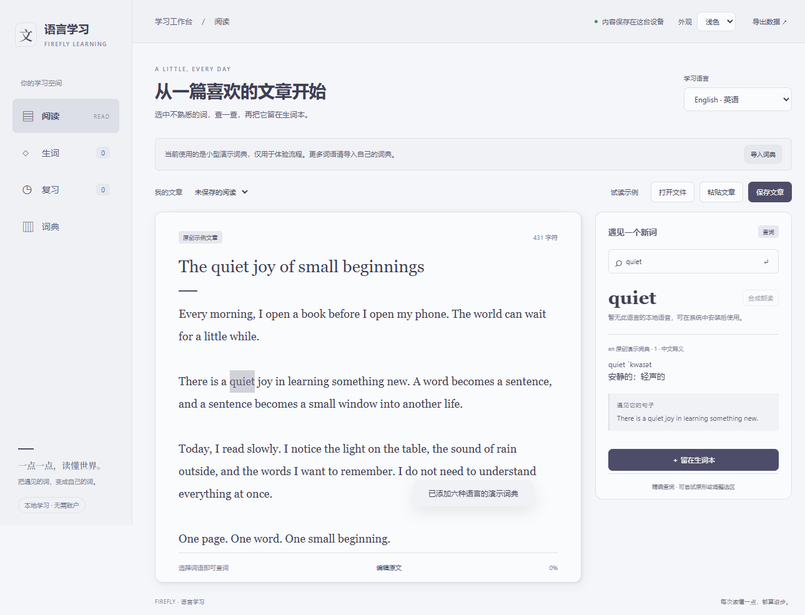
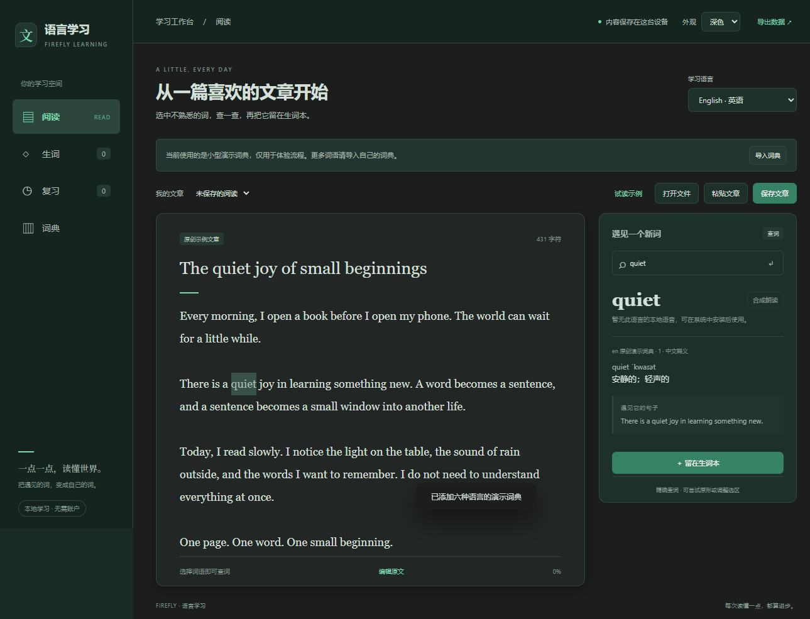

# 语言学习深浅主题验收

2026-11-01。用户接受原插件预览后要求按 Firefly 最新界面改为深浅两套主题，并继续实现及 PR 至 main。原功能提交 a77c67b，本次后续提交只改主题、窗口配置与验证材料，卡片/词典后端不变。

## 配色依据

重新 fetch 并确认 Firefly-Agent main 为 `be9355b81988ebbfbdf45d9a7469a9a3a4f2d932`。读取该提交的 `src/renderer/react/styles/react-root.css`、`src/renderer/ui/glow.css` 及 `src/shared/ui-theme.ts`，没有从旧本地源码猜颜色。

| 角色 | 浅色 pearl-white | 深色 firefly-dark |
| --- | --- | --- |
| 窗口底色 | #f5f6f9 | #192a24 |
| 侧栏 | #eff1f5 | #152420 |
| 阅读卡片 | #fafbfc | #222625 |
| 强调色 | #4d4e69 | #7bd8ae |
| 主按钮 | #4d4e69 | #318364 |
| 默认文字 | #3d3e55 | #d5e0db |
| 弹窗 | #f1f2f6 | #1b1e1d |
| 弹窗边框 | #dfe1e8 | #3b4240 |

深色中央采用 glow.css 的中性阅读底色。最终弹窗颜色采用该文件靠后的实际覆盖规则，没有停留在 react-root.css 较早的 #20342d。相关 MIT 来源说明随 ui/theme.css 与 README 分发。

## 行为

- 右上角「外观」选择浅色/深色，使用插件公开 ctx.storage 保存，默认浅色。独立于宿主设置，不读取宿主私有配置或宣称实时同步。
- Native BrowserWindow 背景、协议返回的初始 HTML、preload 初始值和下拉选择均来自同一已校验主题；重开直接使用保存值。
- 窄 IPC 仅接受两个固定主题及 theme 字段，保持主 frame/sender 校验；不提供任意 CSS 或路径入口。写入失败恢复原选择并显示错误。
- 页面、侧栏、查词卡、阅读选区、生词、复习、表单、提示和弹窗改用语义颜色变量。主题切换不会重载文章或丢失查词结果。

## 测试和实际窗口

- TDD：新增 renderer 初始主题/保存/失败恢复/禁用期间操作，以及 native 第一帧、持久化、无效字段、损坏配置和保存失败测试。初次为4项失败；补充损坏配置先复现类型转换失败，再修复为安全默认。
- 139 项 Node 测试通过，包含原134项，没有跳过/删除原行为测试；build/check 通过。新资源进入显式 package-files 清单。
- 额外六个插件包的基线哈希不变。study-cards仍为尚未发布的0.2.0，不创建Release。
- 一次独立主题审查指出遗漏 glow.css 后续弹窗覆盖；实际 Electron 将预期更新后先观察 RED（原值rgb32,52,45），修复后 GREEN（rgb27,30,29，边框rgb59,66,64）。详见配套主题审查报告。
- 最终正常 Electron 安装/启用/窗口运行：`.test-tmp-learning-native-W9K2ed/native-result.json`，`passed:true`，`themeReopen:true`。验证切换时颜色、原文不变、深色收词弹窗、停用/重新启用后的主题值一致；同时复跑六语言演示查词、收藏/评分/文章保留及日语本地语音结束回调。
- 截图：该目录内 `learning-reader-pearl-white.png`、`learning-reader-firefly-dark.png`、`learning-collect-dark.png`、生词/复习/词典深色页面。截图等待 CSS 背景过渡结束，避免把中间过渡色当成主题最终色。
- 本轮未重新导入六份真实词典，native记录real为空；原功能阶段六份WTY glossary、263472词条的导入/查词证据保留于2026-10-31-learning-workbench.md。未将演示数据计为新的真实词库覆盖。

## 可复跑

| 浅色实际窗口 | 深色实际窗口 |
| --- | --- |
|  |  |

[深色收词确认弹窗](images/learning-collect-dark.png)。均为实际插件窗口，展示原创示例文章与演示词典。

```powershell
npm run build
node scripts/validation/learning-native.cjs E:/Codex/Firefly/firefly-agent
npm test
npm run check
git diff --check
```

实际使用宿主已编译的 PluginManager 和其现有 Electron/Playwright，不新增插件运行依赖，不改正式 profile。跨平台 CI 结果以实现 PR 的实际运行状态为准。没有发布/合并动作；源码PR目标main。
